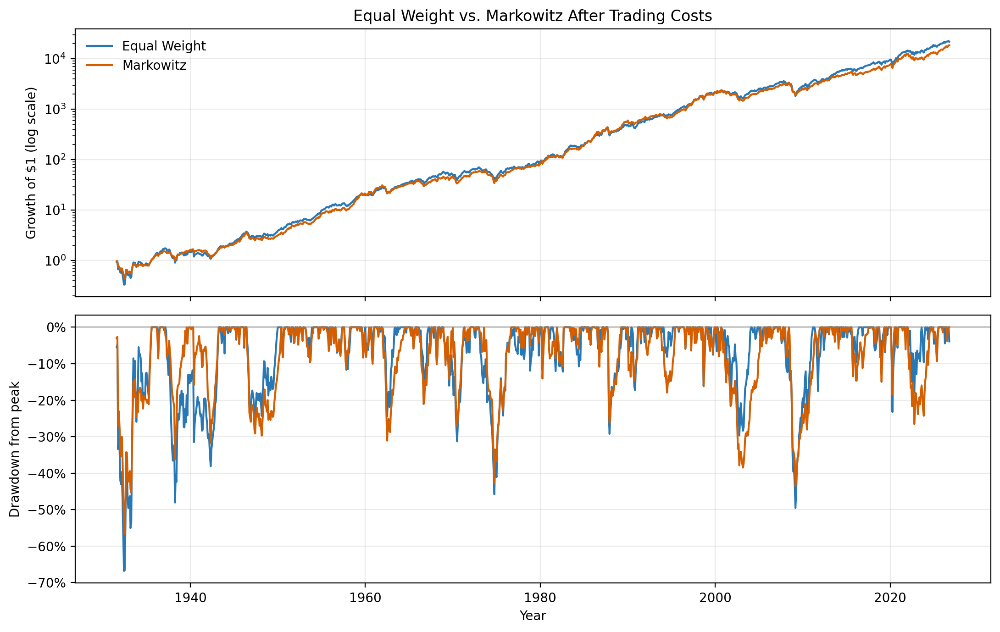

# Can Portfolio Optimization Beat Equal Weight?

A Python backtest comparing equal weighting (1/N) with long-only Markowitz mean–variance optimization across 12 U.S. industry portfolios.

[View the full notebook](Equal_Weight_vs_Markowitz.ipynb)

## Key finding

Markowitz delivered a higher Sharpe ratio and a smaller maximum drawdown over the full backtest, but equal weight compounded faster and traded much less. Markowitz's Sharpe advantage was concentrated in the first half of the sample.

## Method

- Used monthly returns from the Kenneth French 12 Industry Portfolios dataset.
- Compared both strategies over 1,143 out-of-sample months, from July 1931 to September 2026.
- Rebalanced monthly. Markowitz used only the previous 60 months to estimate returns and covariances; equal weight allocated 1/12 to each industry.
- Estimated trading costs from the amount reallocated after accounting for weight drift. The base case assumed 10 basis points per dollar reallocated.

## Results after estimated trading costs

| Metric | Equal Weight | Markowitz |
|---|---:|---:|
| Annualized compound return | **11.06%** | 10.87% |
| Annualized volatility | 17.91% | **15.63%** |
| Sharpe ratio (0% risk-free rate) | 0.677 | **0.742** |
| Maximum drawdown | −66.81% | **−56.69%** |
| Average monthly turnover | **1.12%** | 9.77% |

## Robustness checks

- **Time periods:** Markowitz led by 0.084 on Sharpe in the first half. Equal weight led by 0.008 in the second.
- **Trading costs:** Raising the assumed cost from 10 to 100 basis points narrowed Markowitz's full-period Sharpe lead from 0.065 to 0.004.

## Limitations

This historical backtest uses research portfolios rather than directly tradable funds. Trading costs are modeled, and the Sharpe ratios assume a 0% risk-free rate rather than historical Treasury bill rates. The results do not establish that either strategy will outperform in the future.
